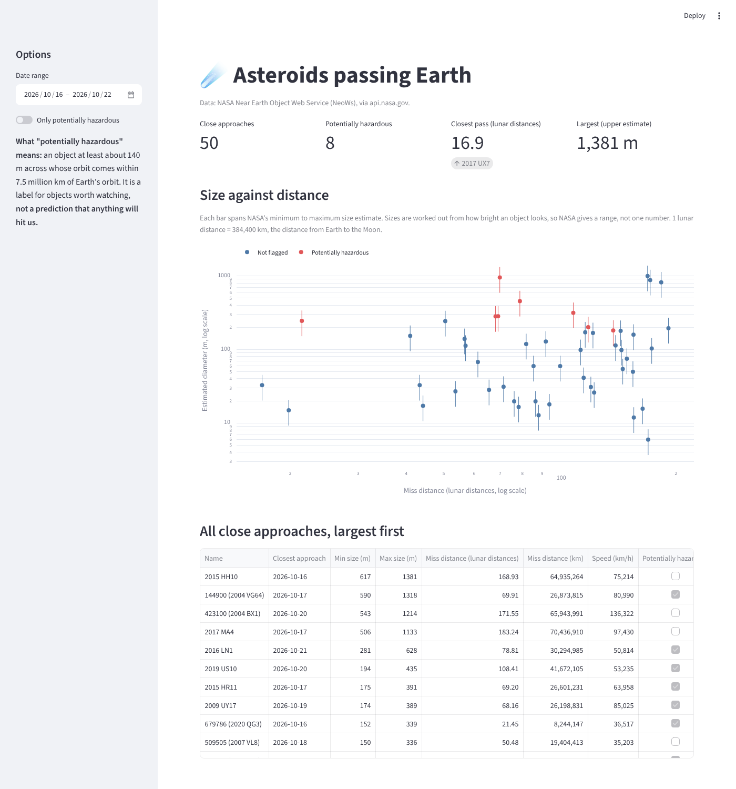

# Asteroid tracker

A dashboard of every asteroid passing close to Earth in the coming days. You
can see how big each one is, how close it comes and how fast it is moving. It
uses live data from NASA.



There is also a short narrated film about what the data actually says:
[`video/asteroids_passing_earth.mp4`](video/asteroids_passing_earth.mp4).

## Run it

```bash
python -m venv venv
source venv/bin/activate        # Windows: venv\Scripts\activate
pip install -r requirements.txt
cp .env.example .env            # then put your key from api.nasa.gov in .env
streamlit run app.py
```

To check your key from the command line, run `python neows.py`. It prints the
ten largest asteroids passing this week.

Run the tests with `pytest`. They work offline.

## What it shows

- **Size against distance chart.** Each dot is one asteroid. Its vertical bar
  runs from NASA's smallest to largest size estimate.
- **Distance in lunar distances.** "0.5" means half the distance from Earth to
  the Moon (1 lunar distance = 384,400 km).
- **Table sorted by size**, with a link to each asteroid's page at NASA JPL.
- **A switch to show only "potentially hazardous" objects.**

## Two things the data does not say

1. **Size is a range, not a number.** NASA works out size from how bright an
   asteroid looks, which depends on how reflective its surface is. So NASA
   gives a minimum and a maximum, about 2.2 times apart. The chart shows
   both instead of picking one.
2. **"Potentially hazardous" is not a warning.** It labels objects about 140 m
   or bigger whose orbits pass within 7.5 million km of Earth's orbit. It means
   "worth keeping an eye on", not "going to hit us".

## How it works

- `neows.py` calls NASA's NeoWs feed. The feed accepts at most 7 days per
  request, so longer ranges are split into weeks and joined. Distances and
  speeds arrive as text and are turned into numbers. NeoWs sometimes lists an asteroid twice
  (as "2020 QG3" and, once numbered, as "679786 (2020 QG3)"), so duplicates are dropped. Weeks that are fully in
  the past are saved to `data/` so they are not downloaded again.
- `app.py` is the Streamlit dashboard.
- `tests/` checks the week splitting, the number conversion and the error
  messages. It uses a small hand-made response, not real data.

## Data

- Source: NASA Near Earth Object Web Service (NeoWs), https://api.nasa.gov
  ("Asteroids NeoWs"). Orbit data comes from NASA JPL's Center for
  Near-Earth Object Studies.
- Pulled live each time the dashboard loads, for the dates you pick.
- Needs a free API key from api.nasa.gov, stored in `.env` as `NASA_API_KEY`.
  `.env` is in `.gitignore` and must never be committed.

## What I would do differently

The best part was working with real NASA data instead of a tidy practice dataset. The hardest part
was how messy that data is: NeoWs sometimes lists one asteroid twice under two names, which quietly
inflated my counts until I caught it and added a test. Next I would add a 3D view of each orbit,
alerts for unusually close passes, and longer date ranges, which would mean caching the data instead
of fetching it week by week.
